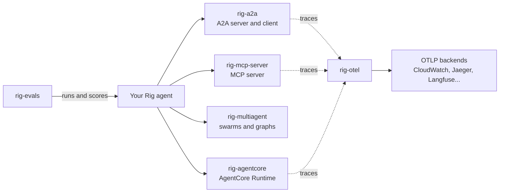

# rig-contrib

[](https://github.com/pingedbrain/rig-contrib/actions/workflows/ci.yml)
[](LICENSE)
[](Cargo.toml)
[](https://github.com/0xPlaygrounds/rig)

Companion crates for [Rig](https://github.com/0xPlaygrounds/rig): agent-to-agent
protocols, multi-agent orchestration, observability, evals and deployment on AWS.
They are maintained outside Rig's repository, and their versions follow Rig's: 0.47.x
works with Rig 0.47.

## Crates

- **[`rig-a2a`](crates/rig-a2a)**: Serve a Rig agent over the A2A protocol (v1.0, and v0.3 for Strands Agents), and call remote A2A agents as Rig tools.  
  [crates.io](https://crates.io/crates/rig-a2a) · [docs](https://docs.rs/rig-a2a)
- **[`rig-mcp-server`](crates/rig-mcp-server)**: Serve Rig agents and tools over the Model Context Protocol, over stdio or Streamable HTTP.  
  [crates.io](https://crates.io/crates/rig-mcp-server) · [docs](https://docs.rs/rig-mcp-server)
- **[`rig-multiagent`](crates/rig-multiagent)**: Swarms of agents that hand work to each other, and graphs of agents and functions; streamed, with a person in the loop, resumable from checkpoints.  
  [crates.io](https://crates.io/crates/rig-multiagent) · [docs](https://docs.rs/rig-multiagent)
- **[`rig-otel`](crates/rig-otel)**: OpenTelemetry in one call: Rig's spans over OTLP, GenAI metrics, sessions and traces across processes, with SigV4 export to Amazon CloudWatch.  
  [crates.io](https://crates.io/crates/rig-otel) · [docs](https://docs.rs/rig-otel)
- **[`rig-evals`](crates/rig-evals)**: Evaluate Rig agents: datasets, built-in and LLM-judge evaluators, AWS AgentCore Evaluations, pass-rate thresholds for CI, JUnit/JSON/Markdown reports.  
  [crates.io](https://crates.io/crates/rig-evals) · [docs](https://docs.rs/rig-evals)
- **[`rig-agentcore`](crates/rig-agentcore)**: Run a Rig agent on AWS Bedrock AgentCore Runtime: its HTTP contract, sessions, streaming and the traces AgentCore reads.  
  [crates.io](https://crates.io/crates/rig-agentcore) · [docs](https://docs.rs/rig-agentcore)

Each crate stands on its own; add only the ones you need:

```sh
cargo add rig-a2a rig-otel
```

## How they fit together



`rig-otel` is the shared piece. With the `otel` feature of `rig-a2a` and
`rig-mcp-server` (always on in `rig-agentcore`), a call from one agent to another
continues the caller's trace and session.

## Verified

- **Interoperability:** CI runs `rig-a2a` against Strands Agents and the official A2A
  SDK in both directions, and `rig-mcp-server` against the official MCP Python SDK,
  over stdio and HTTP.
- **AWS:** `rig-agentcore`, `rig-otel` and `rig-evals` were run on AWS Bedrock
  AgentCore, with traces in CloudWatch and AgentCore Evaluations scoring the agent; see
  [rig-agentcore's README](crates/rig-agentcore#verified-on-aws).
- **Every push:** the tests of every crate, Clippy with Rig's workspace lints, the MSRV
  and `cargo-deny`; weekly, the newest compatible Rig.

The code follows Rig's own lints and conventions, so a crate here could move into
Rig's repository as it is.

## Issues

Each crate has a label (`rig-a2a`, `rig-otel`, ...). Open issues in this repository and
pick the crate's label, or name the crate in the title.

## License

MIT. `rig-a2a` adapts code from Rig (0xPlaygrounds/rig#2820) and carries its notice.
